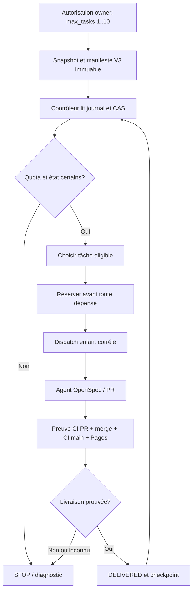

# ASF V3 : architecture cible et ADR de cadrage

**Statut : proposition technique à revoir, non implémentée.** Source de conception : [ASF-V3-001](tasks/ASF-V3-001.md). Décisions fonctionnelles exprimées le 16 octobre 2026 ; les mécanismes de déclenchement et de sécurité décrits ci-dessous sont des **propositions**, pas des permissions ou capacités livrées.

## 1. Décisions et limites

| Aspect | Cible V3 première mise en service | Nature |
| --- | --- | --- |
| Quota | `max_tasks` numérique entier strict de 1 à 10 ; 0, 11, décimales et formats invalides refusés avant tout effet | Décision propriétaire |
| Extension | Prévoir le versionnement pour 15, mais ne pas activer >10 sans recette distincte | Décision propriétaire |
| Concurrence | `maxConcurrentTasks=1`, aucun développement payant parallèle au sein de la vague | Invariant conservé |
| Relances payantes | `maxPaidRetries=0` ; une réservation persistée ne peut être rejouée | Invariant conservé |
| Livraison | Sélection suivante seulement après PR/SHA, `check` indépendant, fusion, CI main et Pages post-fusion vérifiés | Invariant conservé |
| Reprise sur panne | Diagnostic et **nouvelle autorisation explicite** ; jamais un reset aveugle de journal | Décision propriétaire |
| Documentation | Description fonctionnelle/technique des workflows en parallèle, dans des PR documentaires autonomes | Décision propriétaire |
| Coûts | Compteur de tâches distinct du nombre d'appels OpenCode et de la dépense réelle ; pas de plafond USD supposé | Politique à instruire |

Ne pas changer le comportement V1 déployé (`max_tasks=1|2`) dans cette PR de conception.

## 2. Sources de vérité V1 et points bloquants

- `.github/workflows/backlog-orchestrator.yml` : deux slots figés (`prepare / first / after_first / second / after_second`).
- `scripts/asf/waves/orchestrate.mjs` : `readInputs()` accepte uniquement `1`/`2` ; `settle()` ferme au slot `2`.
- `scripts/asf/waves/manifest.mjs` : `MAX_TASK_STARTS=[1,2]` et schéma strict.
- `scripts/asf/waves/authenticate-executor.mjs` : exige parent `workflow_call` owner/main en cours, run ID égal au parent et quota au plus 2.
- `scripts/asf/waves/journal.mjs` et `store.mjs` : réservations et CAS existants à préserver/faire évoluer sans mutation de l'historique.
- `scripts/asf/delivery/` : vérification indépendante des PR, SHA, CI et Pages ; jamais « job succeeded = delivered ».
- `agent-openspec.yml` : chemin manuel à préserver et mode appelé par V1 à authentifier avant toute phase payante.

Références : [étude d'échelle](scale-to-ten.md), [guide V1](backlog-orchestrator-manual.md), [rapport de clôture V2](closeout-2026-10-16.md).

## 3. Découpage cible en composants

1. **Entrée propriétaire** : nouveau formulaire numérique `max_tasks`, validation stricte avant lecture d'un jeton d'écriture, autorisation limitée à une vague, modèle et périmètre initial.
2. **Contrôleur déterministe** : sélection depuis un snapshot immuable, réservation durable, dispatch, observation, consolidation et éventuelle sélection suivante. Aucun modèle IA dans le scheduler.
3. **Store de vague** : manifeste immuable versionné, journal append-only, écriture conditionnelle sur SHA attendu, curseur/revision et état d'arrêt. La branche de vague historique V1 est conservée.
4. **Exécuteur OpenSpec** : implémente UNE tâche sélectionnée, mais refuse tout appel payant sans preuve vérifiée de réservation et parenté autorisée. Il demeure utilisable en mode manuel.
5. **Vérificateur GitHub indépendant** : confronte workflow enfant, PR, auteur, branche, SHA, protections, `check`, merge, CI main et Pages à l'état journalisé.
6. **Observabilité** : compte réservations, appels payants observés, résultats, durées et coûts seulement lorsqu'ils sont mesurables et attribuables ; redaction systématique des secrets.

### Diagramme logique cible

Ce diagramme n'implique **pas** qu'un unique job reste actif pendant dix tâches. La séparation en runs/continuations reste à spécifier et sécuriser dans ASF-V3-002/003.

## 4. Contrat de vague et états versionnés proposés

Ne pas étendre silencieusement le schéma V1. Créer un `schemaVersion: 2` et une nouvelle `policyVersion` après ADR validée. Lire les vagues V1 historiques en lecture seule, sans conversion/réécriture. Une vague V3 nouvelle contient au minimum :

- Identité immuable : repository, waveId, source main SHA, owner initial, run d'autorisation, politique, modèle, phase, autoMerge, liste des tâches candidates et empreintes SHA-256 de leurs octets exacts.
- `limits.maxTaskStarts` (entier 1..10), `limits.maxConcurrentTasks=1`, `limits.maxPaidRetries=0` ; interdiction de relever ces limites en cours de vague.
- Journal append-only avec révision/sequence monotones, empreinte du manifeste, tâche/slot, réservation, identifiants des runs parent et enfant, preuves de livraison et horodatages observés.
- Politique explicite de conservation : aucune valeur de secret, aucun identifiant de permission inventé, pas de mutation de la définition de tâche autorisée.

Transitions conceptuelles : `CREATED -> READY -> SELECTED -> DISPATCH_RESERVED -> EXECUTING -> PR_PUBLISHED -> CI_PENDING -> MERGE_PENDING -> DELIVERED -> CHECKPOINT -> READY` ; sorties `COMPLETE`, `NO_WORK`, `WAITING_DEPENDENCIES`, `STOP_FAILED`, `STOP_UNCERTAIN` et `PAUSED_REVIEW`. Ce sont des **états de conception** à rapprocher des événements V1 existants, non une API déjà livrée.

Quota : `taskStartsReserved` croît uniquement après une écriture durable validée, ne décroît jamais et ne dépasse jamais `maxTaskStarts`. Un dispatch incertain après réservation ne libère pas sa place. Une tâche déjà tentée n'est pas redémarrée en prétendant qu'il s'agit d'une nouvelle tâche.

## 5. Deux notions distinctes de continuation

**Continuation nominale entre runs après DELIVERED confirmé :** le déclenchement initial du propriétaire peut couvrir jusqu'à dix tâches, même si plusieurs runs techniques sont nécessaires. Une continuation automatique n'est envisageable que si l'identité et la chaîne de provenance du **même mandat initial**, la version de politique, la réservation et le journal sont authentifiés de façon indépendante, sans élargissement du quota. Ce comportement **n'est pas autorisé à implémenter** par ce document.

**Reprise après panne, ambiguïté, annulation ou timeout :** l'état reste figé ; les réservations déjà engagées restent consommées. Le propriétaire inspecte manifeste, journal, run enfant, PR et preuves, puis autorise explicitement une opération de réconciliation ou une nouvelle vague. Aucune relance payante automatique de la tâche interrompue, aucun effacement, aucune modification de l'historique.

Si la distinction entre continuation nominale et reprise ne peut pas être prouvée techniquement, **échouer fermé** et demander une intervention explicite plutôt que dispatcher.

## 6. Authentification, permissions et anti-replay

Le modèle actuel `workflow_call` repose sur une preuve de parent owner `in_progress` et sur un ID de run commun. Il ne peut pas être simplement transposé à des workflows enfants `workflow_dispatch` indépendants. Le futur contrat devra vérifier :

- L'autorisation originale owner/`main` et le SHA de départ contre les faits GitHub, pas contre une entrée fournie par le demandeur.
- Un identifiant de run enfant corrélé à la réservation persistée, au modèle autorisé, au `taskId` et au SHA exact du brief, plus `run_attempt=1` ou équivalent contrôlé.
- Un verrou global des développements payants et un mécanisme de revendication atomique d'une seule réservation, résistant aux dispatchs parallèles, aux replays et aux crashs entre écriture et appel API.
- La séparation de l'exécution non fiable et de la publication privilégiée ; jeton App à durée/scope minimaux, délivré au dernier moment, jamais exposé au modèle.
- Une politique distincte, revue humainement, avant d'étendre les droits GitHub App (en particulier `Actions: write` pour dispatcher). Aucun élargissement de `Workflows: write` dans le présent lot.
- PR obligatoires, `Protect Main` et vérification indépendante du `check` sur SHA exact ; aucun bypass.

**Piste API (non vérifiée sur le dépôt en exécution) :** GitHub expose depuis février 2026 une option `return_run_details` sur la création de `workflow_dispatch`, fournissant un ID de run lors d'une réponse réussie. Voir [documentation officielle de l'API](https://docs.github.com/en/rest/actions/workflows#create-a-workflow-dispatch-event). Le contrôleur devra enregistrer l'ID de manière durable et traiter une réponse réseau ambiguë comme `STOP_UNCERTAIN`, même si aucun ID n'a été reçu. Cette API ne dispense pas de vérifier la provenance du run ni d'empêcher un double départ.

## 7. Temps, coûts, déploiement et rollback

GitHub Actions limite les jobs hébergés à six heures et le workflow à une autre limite, selon la [documentation GitHub](https://docs.github.com/en/actions/reference/limits). Ne pas concevoir une boucle monolithique supposée éternelle. Chaque étape dispose d'un timeout explicite, d'un checkpoint et d'un diagnostic vérifiable. Les délais CI/Pages seront configurés après simulation, et non extrapolés des sept minutes V1.

La limite de dix ne constitue **pas** une limite USD : une tâche OpenSpec `auto` peut provoquer plusieurs appels modèles. Spécifier avant les pilotes payants une estimation visible de coûts, les données de consommation disponibles, un seuil d'arrêt lorsque applicable et la conduite à tenir si la télémétrie échoue. Ne promettre un plafond dur que si un mécanisme fournisseur l'impose effectivement.

Déployer sur un chemin V3 séparé ou sous un `feature flag` explicite, puis qualifier les paliers 1/2 (non-régression), 3, 5 et 10 ; ne pas autoriser 15 par configuration avant recette indépendante. Rollback = arrêter les nouvelles vagues V3, préserver les journaux et conserver le parcours V1/manuels ; ne jamais réinterpréter une réservation V3 comme une vague V1.

## 8. Matrice de validation pour les futurs lots

| Cas | Comportement attendu |
| --- | --- |
| Entrées 0, 11, -1, décimale, vide ou non numérique | Refus **avant** token, réservation et appel modèle |
| 1, 2, 3, 5, 10 | Au plus N réservations, une seule active à la fois |
| Onzième départ sur quota 10 | Refus déterministe |
| Brief modifié après gel | `STOP_UNCERTAIN` ; ne pas exécuter le nouveau contenu |
| Double dispatch/replay/accès concurrent | Une seule réservation consommée, pas de second appel payé |
| Crash avant, pendant ou après dispatch | Réconciliation sans relance payante non autorisée |
| Job enfant « success » sans PR livrée | Aucune sélection suivante |
| PR/CI/Pages rouges ou inconnues | Stop, preuve conservée, zéro remplacement |
| Fin normale proche de limite de temps | Checkpoint durable puis continuation seulement sur mandat initial prouvé |
| Panne/API non disponible | Fail-closed, sans inventer une preuve négative |
| Vague V1 historique | Lecture intacte ; aucun reset/réécriture |
| Mode manuel produit | Comportement inchangé et tests de non-régression |

## 9. Lots de PR à affiner après validation de cette ADR

1. ASF-V3-002 : contrôleur pur, manifeste V3, CAS/journal et tests des frontières.
2. ASF-V3-003 : authentification indépendante des workflows enfants, anti-replay et preuve d'autorisation.
3. ASF-V3-004 : intégration GitHub Actions, dispatch, contrôles post-livraison et sécurité de publication.
4. ASF-V3-005 : observabilité, budgets, erreurs et politique de pause.
5. ASF-V3-006 : déploiement/rollback et pilotes progressifs autorisés un à un.
6. ASF-V3-EXEC-001 (intitulé provisoire) : généraliser l'Agent ASF hors des IDs V2 par **politiques versionnées et profils de risque distincts**, en conservant une voie humaine spéciale pour les workflows, les droits et la politique de publication.
7. ASF-V3-DOC-001 : cartographier et décrire chaque workflow, job et step, en parallèle des changements techniques.

## 10. Arbitrages encore ouverts

- Définition exacte et vérification du **mandat de continuation** inter-runs : nouveau workflow contrôleur ou `repository_dispatch`, conditions d'activation, mécanisme d'idempotence.
- Le choix entre une saisie `type: number` (native GitHub Actions) et une entrée textuelle strictement parsée, ainsi que l'UX d'erreur ; l'exigence est **numérique entière 1..10**.
- Timeouts, horizon maximal d'une vague et comportement des PR non fusionnées lorsque `auto_merge=false`.
- Télémétrie financière disponible et budget effectif autorisé ; une simulation n'autorise pas de dépense.
- Contrat précis de reprise : dans quels états une réconciliation non payante peut simplement confirmer `DELIVERED`, et lesquels imposent une nouvelle vague avec nouvelle autorisation.
- Protocole de revue préalable des changements de workflows ou de permissions, distinct de l'Agent ASF générique.

La validation de cette ADR par revue documentaire ne constitue pas une autorisation de construction, de fusion, de modification de droits ni de dépense.
