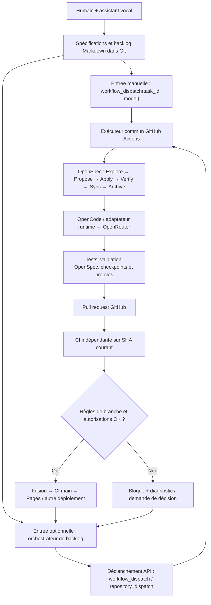

# Architecture technique et contrats

## 1. Principe structurant

**Une seule chaîne d'exécution**, invoquée soit via UI GitHub Actions, soit via API par un orchestrateur. La stratégie de déclenchement ne doit changer ni les artefacts produits, ni les validations, ni les permissions.



**Attention :** ce diagramme illustre l'architecture **cible**. Le chemin manuel OpenSpec fonctionne (TS-008, PR #21) ; l'orchestrateur externe `O`, les plafonds budgétaires et le stockage transactionnel ne sont pas implémentés. Le workflow utilise désormais un jeton de GitHub App pour publier les PR, et la CI sur PR #21 a réussi. Voir [l'état courant](current-state.md).

## 2. Couches proposées (ports et adaptateurs)

| Composant | Contrat / responsabilité | Adaptateur initial |
| --- | --- | --- |
| `TaskRepository` | Lire/écrire `TaskSpec`, statut et dépendances | fichiers `backlog/tasks/*.md` |
| `Planning` | Analyser la demande, créer tâches et artefacts de planification | assistant conversationnel + PR documentaire |
| `Dispatcher` | Contrôler autorisation, priorités, budgets et verrous | `workflow_dispatch` manuel, puis adaptateur API |
| `DevelopmentProtocol` | Enforcer phases et invariants OpenSpec | CLI/skills OpenSpec versionnés |
| `CodingRuntime` | Exécuter un agent sans dépendance fournisseur dans le domaine | OpenCode/OpenRouter ; autre agent possible |
| `Workspace` | Branche de travail, Git, checkpoints, base SHA | GitHub et git |
| `Validator` | Valider specs + code + sécurité | OpenSpec strict + tests/CI GitHub |
| `Publisher` | PR, vérifications, fusion/config de livraison | API GitHub/CLI + politique de protection |
| `RunStore` | Conserver run ID, curseur, verdict, erreurs, URL | commits Git + artefacts de runs puis stockage transactionnel si multiworkers |
| `Notifier` | Synthèse de progression et blocage | commentaires PR/issue, statuts, liens GitHub |

Les types de l'API GitHub et d'OpenCode restent aux frontières des adaptateurs.

## 3. Contrat logique d'une exécution

Champs minimaux, à versionner et valider avant implémentation :

```json
{
  "schemaVersion": 1,
  "taskId": "TS-004",
  "repository": "cedricmenec/threadstep",
  "baseRef": "main",
  "baseSha": "<sha>",
  "protocol": "openspec",
  "model": "openrouter/deepseek/deepseek-v4.1-flash",
  "delivery": "pull_request",
  "authorizationId": "<human-approved-id>",
  "budget": { "maxUsd": 1.0, "maxAttempts": 2, "timeoutMinutes": 20 },
  "source": "manual"
}
```

Cet exemple est **une cible**, pas un fichier de configuration actif ni un plafond actuellement garanti. `source` pourra être `manual` ou `orchestrator` ; toutes les autres règles demeurent identiques. Ne jamais inclure de valeur de secret.

Résultat attendu : `runId`, `taskId`, `state`, `workingBranch`, `commitSha`, `openspecChangeId`, `prUrl`, `validationEvidence`, `cost` (si fiable), `errorCode`, `nextAction`.

## 4. Machine d'états envisagée

`proposed → ready → authorized → running → validating → pull_request_open → ci_passed → delivered → archived`

États alternatifs : `blocked`, `failed`, `cancelled`, `retryable`. État `completed` uniquement après publication effectivement vérifiée et artefacts synchronisés/archivés. L'orchestrateur doit détecter un résultat préexistant et ne pas créer de PR dupliquée.

**Durabilité :** branche `agent/TS-NNN` ou `factory/<run-id>` préparée avant travail ; checkpoint poussé et SHA distant vérifié après chaque tâche OpenSpec ; reprise depuis la branche distante sans force-push. Étudier la politique de checkpoint déjà expérimentée dans `mestryn` (un item OpenSpec achevé = commit/push/sha vérifié).

## 5. Historique du prototype initial (avant le cycle OpenSpec TS-008)

- `.github/workflows/agent.yml` : **déclenchement manuel** `task_id` et `model`, propriétaire uniquement, 20 minutes ; création/réutilisation branche `agent/TS-NNN`, OpenCode → OpenRouter, `npm run check`, PR avec `GITHUB_TOKEN`.
- `.github/workflows/ci.yml` : `pull_request` et `push` vers `main`, `npm run check`.
- `.github/workflows/pages.yml` : tests et publication du dossier `site/` sur GitHub Pages après push sur `main`.
- Backlog et `AGENTS.md` : directives de cadrage et exécution ; **pas de scheduler**, pas de statut transactionnel, pas de suivi de budget API, pas d'OpenSpec installé/configuré dans ThreadStep.
- PR #4 (TS-004) fusionnée ; CI `main` et Pages réussis. PR #2 (TS-002) conservée ouverte.
- `main` ne présentait **pas de protection de branche** lors de la vérification ; un succès ponctuel de tests ne remplace pas cette protection.

**Situation au 15/10/2026 :** les affirmations précédentes décrivent le prototype initial et ne doivent pas servir d'état courant. Le cycle OpenSpec complet est implémenté et a livré TS-008 via PR #21. La nouvelle intégration Agent Skills/OPSX et le garde-fou d'empreintes restent non testés en E2E. [Statut actuel et preuves](current-state.md).

## 6. Séparation factory / application

Durant le pilote, le dépôt applicatif contient temporairement les workflows et règles. La future factory sera versionnée et réutilisable (dépôt dédié, action composite, workflows réutilisables et/ou service orchestrateur). Elle ne devra pas imposer le frontend, le langage ou la source de tâches de ThreadStep.
